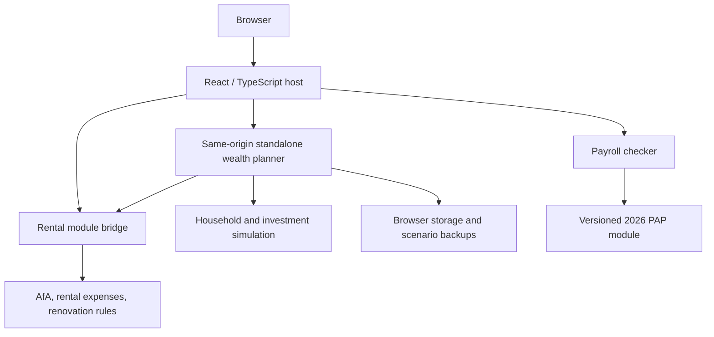

# Application architecture

Status: current runtime overview with retained Version 1 module contracts  
Updated: 20 November 2026  
Original module contract: FND-003 / architecture 1.0.0

## Current deployed entry point

The production entry point is [src/main.tsx](../src/main.tsx), which mounts a minimal React host containing a same-origin iframe for [public/wealth-planner.html](../public/wealth-planner.html) and the additive [2026 payroll checker](../src/components/Payroll2026Panel.tsx).



- The standalone file owns the active planning UI, simulation, visualizations and scenario storage. It is copied as a static asset by the build.
- The host registers `window.__immopilotRentalV2` before mounting the iframe; the bridge exposes shared TypeScript AfA, expense and renovation classification functions.
- The 2026 payroll checker is an additive component, not a replacement for the standalone household simulation.
- The shared ETF primitives and annual projection modules exist under `src/domain/`, but the annual projection is not wired to the production planner. Preserve the [ETF release constraints](etf-002-projection-limitations.md).
- The original React feature tree and hash routes remain source assets, but the old application shell is not the active production entry point.

The existing TypeScript domain boundaries below remain the target contract for incremental migration. Do not assume the standalone simulations already share every domain function. For migration, identify the live calculation path, establish independent golden vectors and browser parity tests, then replace duplicated rules behind explicit interfaces rather than introducing parallel models. Do not change persisted scenario schemas silently.

## Original module contracts

The remaining sections record the original feature-oriented architecture and continue to guide shared modules. References to the old application shell are historical, not a claim that the current host renders that router.

## Purpose

ImmoPilot DE uses a client-side, feature-oriented architecture with a framework-free financial
domain. The structure keeps the formulas defined by PD-007 independent from React, browser
storage, localization and presentation concerns.

## Source layout

```text
src/
├── app/                 Application composition root and shell
├── components/          Reusable, feature-neutral UI components
├── config/              Versioned assumptions and application configuration adapters
├── domain/              Pure financial models, validation and calculations
│   ├── acquisition-costs/
│   ├── financing/
│   ├── refinancing/
│   ├── rent-vs-buy/
│   ├── rental-investment/
│   └── scenarios/
├── features/            User-facing vertical slices and workflow orchestration
├── i18n/                Locale setup, translation resources and formatting adapters
├── storage/             Browser persistence, URL sharing and JSON import/export
├── styles/              Design tokens, global defaults and application styles
├── test/                Cross-cutting test setup, builders and fixtures
├── main.tsx             Browser entry point
└── vite-env.d.ts        Vite environment types
```

The styles directory separates the FND-012 token contract and global accessibility rules from the
FND-013 shell and overview-page composition. The app directory owns hash-based routing and reusable
shell components; feature routes render through its outlet. Domain folders contain their implemented models, validation and tests; consult the current source tree.

## Dependency direction

| Source area | May depend on | Must not depend on |
| --- | --- | --- |
| `app` | Every source area | — |
| `features` | `components`, `config`, `domain`, `i18n`, `storage` | `app` |
| `components` | Feature-neutral utilities and localization helpers | `app`, `features`, `storage` |
| `config` | Domain types and versioned data | `app`, `components`, `features` |
| `i18n` | Translation resources and locale utilities | `app`, `components`, `features` |
| `storage` | Domain types, schemas and serialization utilities | `app`, `components`, `features` |
| `domain` | Standard language features and domain-local modules | React, browser APIs, and every other source area |
| `test` | Any source area under test | Production modules must never import from `test` |

ESLint enforces the principal reverse-dependency restrictions. Code review remains responsible
for semantic boundaries that import-pattern rules cannot express completely.

## Domain rules

- Domain functions are deterministic and accept every changing assumption as explicit input.
- Monetary calculations follow PD-007 and use integer cents or the approved decimal library.
- Domain modules do not read the clock, browser globals, local storage, URL state or translations.
- Validation errors use stable codes. User-facing German and English messages belong to `i18n`.
- Each domain owns its input types, validation, calculation functions and unit tests.
- Cross-domain scenario composition belongs to `domain/scenarios`, not an individual calculator.

## Feature rules

- A feature is a user workflow, such as purchase costs, mortgage planning or scenario comparison.
- Features orchestrate domain functions and infrastructure adapters but do not duplicate formulas.
- Feature-specific components stay inside their feature. A component moves to `components` only
  when at least two features need the same feature-neutral behavior.
- The `app` directory wires features into routing and the shared shell. Features never import it.

## Public module APIs

When implementation begins, each domain, feature and infrastructure module exposes its supported
surface through an `index.ts` file. Callers import from that public entry point and do not reach
into another module's internal folders. Relative imports are used within a module. Cross-module
aliases may be introduced later only when both TypeScript and Vite resolve them identically.

## Configuration, localization and storage

- `config` loads and adapts the versioned PD-008 assumption set. It does not silently mutate
  defaults or contain UI state.
- `i18n` owns translation initialization, resources and locale-aware display formatting. It never
  changes numerical calculation inputs.
- `storage` owns local-storage records, shareable URL encoding and JSON import/export. It validates
  external payloads before returning domain data and contains no financial calculations.

## Testing conventions

- Unit and component tests are colocated as `*.test.ts` or `*.test.tsx` beside their subjects.
- Browser tests live in the root-level `e2e/` directory and exercise production builds across
  representative viewport sizes.
- `src/test` contains only shared setup, builders and helpers. Production code cannot import it.
- Normative PD-007 and PD-010 fixtures remain under `data/fixtures` and are consumed without
  rewriting their expected results.

## Current implementation boundary

Routing, localization, design tokens, the responsive shell and the framework-free Version 1 domain
calculations are implemented. Purchase costs, financing, results, browser-local scenarios, JSON and
URL portability, and three-property comparison are connected through the shared scenario workspace.
PF-004 adds Sondertilgung inputs and selects the existing additional-repayment schedule for affected
downstream results under the approved product contract.
